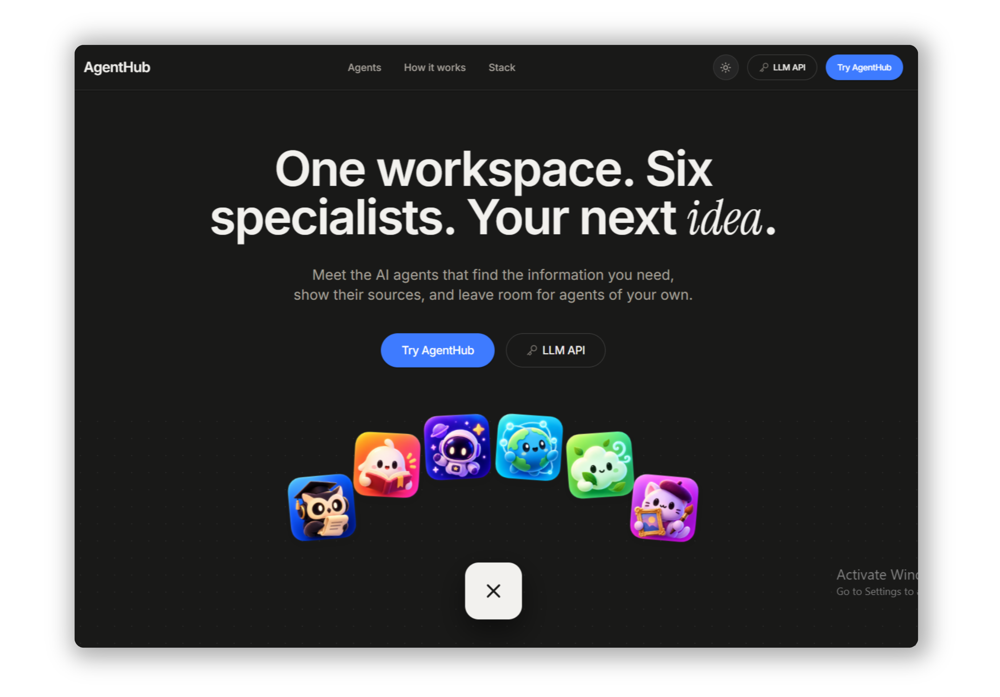
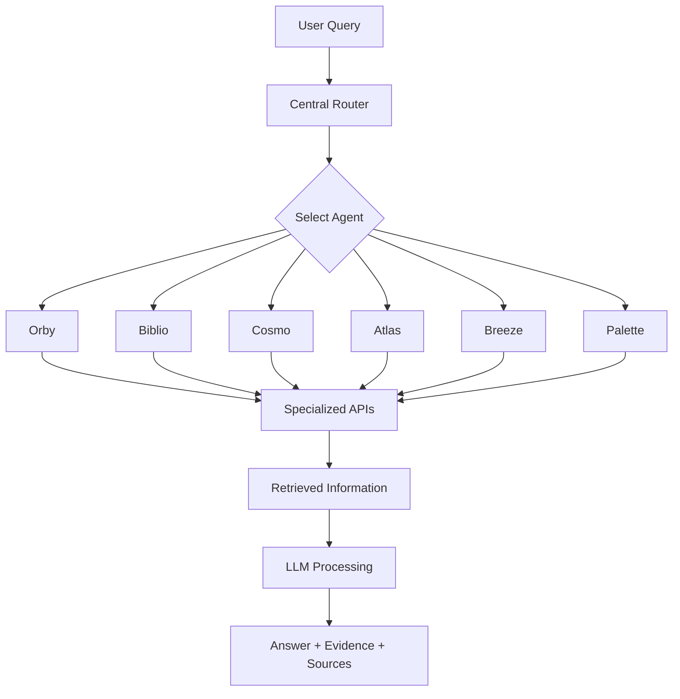

<div align="center">
  


[Overview](#-overview) • [Agents](#-meet-the-agents) • [Architecture](#-how-it-works) • [Tech Stack](#-tech-stack) • [Setup](#-getting-started)

<h1 align="center"><strong>AgentHub</strong></h1>
<p align="center"><strong>One hub for AI agents, tools, and smarter answers. Ask anything, explore any domain, and get evidence-backed insights.</strong></p>
</div>

---

## ✦ Overview

General-purpose AI assistants are useful, but different questions often require different tools, data sources, and workflows.

**AgentHub** brings six specialized AI agents into one unified platform. Each agent focuses on a particular domain, retrieves relevant information through dedicated APIs, and uses an LLM to generate meaningful responses grounded in that information.

Unlike a conventional chatbot, AgentHub emphasizes transparency by preserving retrieved evidence, source links, and tool-call information.

The platform is also designed to let users create their own custom agents and bring their own LLM API keys.

## ✦ Meet the Agents

<table>
<tr>
<td align="center" width="33%">
<h3>🦉 Orby</h3>
<b>Academic Research</b>
<p>Discovers academic research papers and provides evidence-based summaries from multiple scholarly sources.</p>
<code>OpenAlex API</code><br/>
<code>arXiv API</code>
</td>
<td align="center" width="33%">
<h3>📚 Biblio</h3>
<b>Books & Reading</b>
<p>Helps readers explore books, including authors, publication details, editions, and other available information.</p>
<code>Open Library Search API</code>
</td>
<td align="center" width="33%">
<h3>🚀 Cosmo</h3>
<b>Space Exploration</b>
<p>Answers space-related queries and fetches relevant space images directly from NASA's database.</p>
<code>NASA Image and Video Library API</code>
</td>
</tr>
<tr>
<td align="center">
<h3>🌐 Atlas</h3>
<b>Knowledge & Entities</b>
<p>Looks up people, places, organizations, and concepts, returning relevant entity information and source links.</p>
<code>Wikidata API</code>
</td>
<td align="center">
<h3>🍃 Breeze</h3>
<b>Air Quality</b>
<p>Retrieves recent air-quality measurements from nearby monitoring stations with units and timestamps.</p>
<code>OpenAQ API</code><br/>
<code>OpenStreetMap Nominatim API</code>
</td>
<td align="center">
<h3>🎨 Palette</h3>
<b>Art & Culture</b>
<p>Discovers artworks and artists from The Metropolitan Museum of Art's collection.</p>
<code>The Met Collection API</code>
</td>
</tr>
</table>

## ✦ How it works

AgentHub uses a central routing system to identify the appropriate specialist for a user's query.

<div align="center">



</div>

**Workflow:**

1. **Ask:** The user submits a natural-language query.
2. **Route:** The central router identifies the appropriate specialist.
3. **Retrieve:** The selected agent fetches relevant information using its tools.
4. **Process:** The configured LLM interprets the retrieved information.
5. **Respond:** AgentHub returns an answer with available evidence and source links.

The current routing implementation uses rule-based keyword and pattern matching.

## ✦ Key Features

- **Specialized AI Agents:** Six agents designed for different domains.
- **Intelligent Routing:** Automatically directs queries to the relevant specialist.
- **External API Integration:** Retrieves information from dedicated data sources.
- **Source-backed Responses:** Preserves evidence and source links.
- **Tool Transparency:** Makes tool-call information available for inspection.
- **Modular Architecture:** Supports adding more agents and integrations.
- **Custom Agents:** Planned functionality allowing users to create their own specialized assistants.
- **Bring Your Own Key:** Planned provider configuration using user-supplied LLM API credentials.

## ✦ Custom Agent Builder

AgentHub aims to let users create their own specialized AI agents without building everything from scratch.

The planned Custom Agent Builder will support:

- Custom agent name and description.
- System instructions and behavior.
- Avatar and visual identity.
- LLM provider and model selection.
- User-provided API credentials.
- Approved tools and integrations.
- Output preferences.
- Agent preview, testing, and reuse.

Custom agents are a planned capability. Tool execution will be restricted to approved integrations rather than arbitrary user-provided code.

## ✦ Bring Your Own LLM API Key

AgentHub follows a **Bring Your Own Key (BYOK)** approach.

The current predefined agents use **Google Gemini 2.5 Flash**.

The planned provider configuration will allow users to choose supported LLM providers and models using their own API credentials.

Users will be responsible for charges imposed by their selected LLM provider.

API credentials must be handled securely on the backend and must never be exposed in frontend code or client-visible responses.

## ✦ Tech Stack

| Category | Technologies |
|---|---|
| Frontend | React, TypeScript, Vite |
| Backend | Python, FastAPI, Uvicorn |
| Agent Framework | LangChain, LangGraph-based workflows |
| LLM | Google Gemini 2.5 Flash |
| Research | OpenAlex, arXiv |
| Books | Open Library |
| Space | NASA Image and Video Library |
| Knowledge | Wikidata |
| Air Quality | OpenAQ, OpenStreetMap Nominatim |
| Art | The Metropolitan Museum of Art Collection API |

## ✦ Project Structure

```text
AgentHub/
│
├── app/
│   ├── agents/
│   │   ├── research_agent.py
│   │   ├── books_agent.py
│   │   ├── space_agent.py
│   │   ├── wikidata_agent.py
│   │   ├── openaq_agent.py
│   │   └── met_museum_agent.py
│   │
│   ├── tools/
│   │   ├── research.py
│   │   ├── books.py
│   │   ├── nasa.py
│   │   ├── wikidata.py
│   │   ├── openaq.py
│   │   └── met_museum.py
│   │
│   └── pipeline.py
│
├── tests/
│
├── frontend/
│
├── requirements.txt
├── .env
└── README.md
```

*Note: This is a representative structure. Refer to the current repository for the exact directory layout.*

## ✦ Getting Started

### Prerequisites

- Python 3.12
- Node.js and npm
- Git
- Required API credentials

### 1. Clone the repository

```bash
git clone https://github.com/ranjeet22/agenthub.git

cd agenthub
```

### 2. Set up the Python environment

```bash
uv venv
```

**Windows PowerShell:**

```powershell
.venv\Scripts\Activate.ps1
```

**macOS / Linux:**

```bash
source .venv/bin/activate
```

Install dependencies:

```bash
pip install -r requirements.txt
```

### 3. Configure environment variables

Create a `.env` file in the location expected by the backend.

```env
GOOGLE_API_KEY=your_gemini_api_key
OPENAQ_API_KEY=your_openaq_api_key
```

Add any other credentials required by your local configuration.

**Never commit your `.env` file or expose API keys in frontend code.**

### 4. Install frontend dependencies

Navigate to the frontend directory:

```bash
cd frontend
npm install
```

Start the development server:

```bash
npm run dev
```

### 5. Run the backend

From the backend project directory, use the actual FastAPI entry point configured in the repository.

For example:

```bash
uvicorn app.main:app --reload
```

## ✦ Running Tests

Run individual integration tests:

```bash
python -m unittest tests.test_met_museum_pipeline
```

Run the complete test suite:

```bash
python -m unittest discover -s tests
```

External API and LLM calls should be mocked where practical to avoid unnecessary API usage and quota consumption.

## ✦ Roadmap

- [x] Academic Research Agent — Orby
- [x] Books Agent — Biblio
- [x] Space Agent — Cosmo
- [x] Knowledge Agent — Atlas
- [x] Air Quality Agent — Breeze
- [x] Art Collection Agent — Palette
- [x] External API integrations
- [x] Central agent routing
- [ ] Complete frontend experience
- [ ] Secure LLM provider configuration
- [ ] Custom Agent Builder
- [ ] User authentication and persistence
- [ ] Advanced agent customization

*Roadmap reflects the project's development direction. Check the repository for the latest implementation status.*

## ✦ Engineering Principles

- **Modularity:** Keep agents and tools independently maintainable.
- **Reusability:** Avoid duplicated logic and agent definitions.
- **Transparency:** Preserve evidence and source attribution.
- **Reliability:** Handle API failures and missing data explicitly.
- **Security:** Protect credentials and sensitive configuration.
- **Testability:** Maintain independent tests for routing and integrations.
- **Extensibility:** Make adding new agents straightforward.

## ✦ Acknowledgements

AgentHub builds on publicly accessible APIs and data sources provided by:

[OpenAlex](https://openalex.org/) ·
[arXiv](https://arxiv.org/) ·
[Open Library](https://openlibrary.org/) ·
[NASA](https://images.nasa.gov/) ·
[Wikidata](https://www.wikidata.org/) ·
[OpenAQ](https://openaq.org/) ·
[OpenStreetMap](https://www.openstreetmap.org/) ·
[The Metropolitan Museum of Art](https://www.metmuseum.org/)

Please follow the terms and attribution requirements of each provider.

---

<div align="center">

### Built to make specialized AI useful, transparent, and customizable.

**AgentHub**

*Built with open data. Powered by specialist agents.*

</div>
