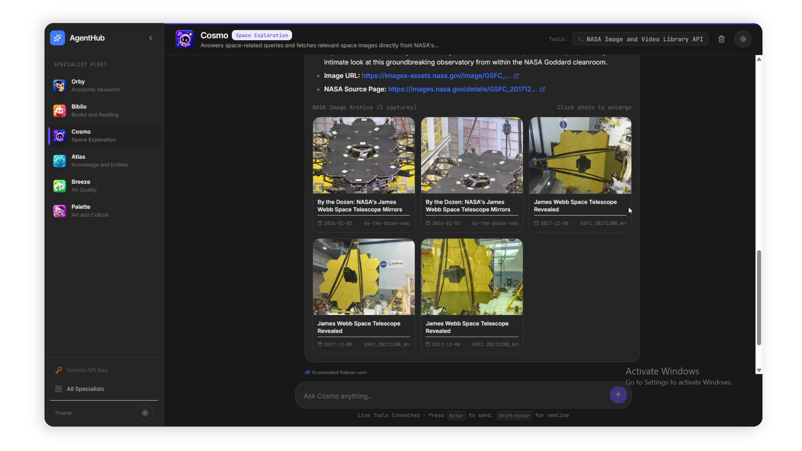
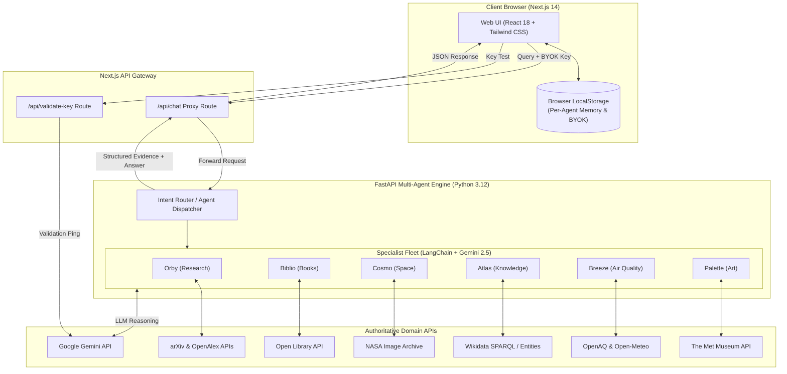

<h1 align="center"><strong>AgentHub</strong></h1>

<p align="center"><strong>
  AgentHub is a hub of AI agents across domains like space exploration, academic research, air quality, and art. Each agent uses APIs such as NASA, OpenAlex, arXiv, Wikidata, and OpenAQ to retrieve relevant information and deliver source-backed answers. Users can also build custom agents tailored to their needs.
</strong></p>
</div>


<div align="center">
  


</div>

<h2 align="center"><strong>Meet the Agents</strong></h2>
<table>
<tr>
<td align="center" width="33%">
<h3>🦉 Orby</h3>
<b>Academic Research</b>
<p>Discovers academic research papers and provides evidence-based summaries from multiple scholarly sources.</p>
<code>OpenAlex API</code><br/>
<code>arXiv API</code>
</td>
<td align="center" width="33%">
<h3>📚 Biblio</h3>
<b>Books & Reading</b>
<p>Helps readers explore books, including authors, publication details, editions, and other available information.</p>
<code>Open Library Search API</code>
</td>
<td align="center" width="33%">
<h3>🚀 Cosmo</h3>
<b>Space Exploration</b>
<p>Answers space-related queries and fetches relevant space images directly from NASA's database.</p>
<code>NASA Image and Video Library API</code>
</td>
</tr>
<tr>
<td align="center">
<h3>🌐 Atlas</h3>
<b>Knowledge & Entities</b>
<p>Looks up people, places, organizations, and concepts, returning relevant entity information and source links.</p>
<code>Wikidata API</code>
</td>
<td align="center">
<h3>🍃 Breeze</h3>
<b>Air Quality</b>
<p>Retrieves recent air-quality measurements from nearby monitoring stations with units and timestamps.</p>
<code>OpenAQ API</code><br/>
<code>OpenStreetMap Nominatim API</code>
</td>
<td align="center">
<h3>🎨 Palette</h3>
<b>Art & Culture</b>
<p>Discovers artworks and artists from The Metropolitan Museum of Art's collection.</p>
<code>The Met Collection API</code>
</td>
</tr>
</table>

<h2 align="center"><strong>Live Chat & Visual Evidence Interface</strong></h2>

> Each specialist goes beyond plain text by rendering rich, domain-specific visual evidence directly inline:

<div align="center">
  


</div>

- **Cosmo (Space Exploration):** Responsive multi-photo grid with high-resolution modal zoom directly from NASA telemetry.
- **Biblio (Books & Reading):** Book jackets with cover images, editions count, publication year, and direct Open Library catalog links.
- **Palette (Art & Culture):** Museum-framed artwork cards featuring medium, dimensions, department, and high-res previews from The Met.
- **Orby (Academic Research):** Interactive cards displaying paper titles, author rosters, abstracts, and direct DOI/PDF links.
- **Breeze (Air Quality):** Live AQI status badges, WHO health categorization, and a breakdown grid for PM2.5, PM10, $\text{NO}_2$, $\text{SO}_2$, $\text{CO}$, and $\text{O}_3$.
- **Atlas (Knowledge Graph):** Entity descriptions, IDs, and direct Wikidata concept URIs.

---
<h2 align="center"><strong>Key Features</strong></h2>

- **Bring Your Own Key (BYOK):** No backend database storing your credentials. Your Google Gemini API key is stored securely in your browser's local storage and sanitized on every request.
- **Shielded Error & Quota Handling:** Friendly UI notifications for rate limits (`429 Quota Exceeded`), invalid keys, or tool timeouts—zero raw stack traces exposed to the user.
- **Hermetic Per-Agent Memory:** Each specialist maintains its own isolated conversation history in browser storage. Switch between agents seamlessly without memory cross-contamination.
- **Contextual Follow-up Chips:** Agents automatically suggest 2–3 relevant follow-up questions after every query for continuous discovery.
- **Dual Theme Support:** Native light and dark theme modes with consistent contrast and zero invisible text.

---
<h2 align="center"><strong>System Architecture</strong></h2>



---
## Tech Stack

| Layer | Technologies |
| :--- | :--- |
| **Frontend** | [Next.js 14](https://nextjs.org/) (App Router), [React 18](https://react.dev/), [TypeScript](https://www.typescriptlang.org/), [Tailwind CSS](https://tailwindcss.com/), [Lucide Icons](https://lucide.dev/) |
| **Backend** | [FastAPI](https://fastapi.tiangolo.com/), [Uvicorn](https://www.uvicorn.org/), [Python 3.12](https://www.python.org/) |
| **Agent Framework** | [LangChain](https://www.langchain.com/), [LangGraph](https://www.langchain.com/langgraph), [Google GenAI SDK](https://ai.google.dev/) |
| **APIs & Data** | NASA Image API, Open Library, OpenAlex, arXiv, Wikidata, Open-Meteo, The Met Collection |
| **Deployment** | [Render](https://render.com/) (Blueprint: Web Service + Static/Node Service) |

---
## Getting Started

### Prerequisites
- Node.js 18.17+ or 20+
- Python 3.12+
- A free [Google Gemini API Key](https://aistudio.google.com/app/apikey)
### Local Setup
1. **Clone the repository:**
   ```bash
   git clone https://github.com/ranjeet22/agenthub.git
   cd agenthub
   ```
2. **Backend Setup:**
   ```bash
   python -m venv .venv
   # Windows
   .venv\Scripts\activate
   # macOS/Linux
   source .venv/bin/activate
   pip install -r requirements.txt
   uvicorn api:app --host 127.0.0.1 --port 8000 --reload
   ```
3. **Frontend Setup:**
   ```bash
   # Open a new terminal in the project root
   npm install
   npm run dev
   ```
4. **Open in Browser:**
   Navigate to [http://localhost:3000](http://localhost:3000), enter your free Gemini API key in the modal or sidebar, and start chatting with any specialist.
